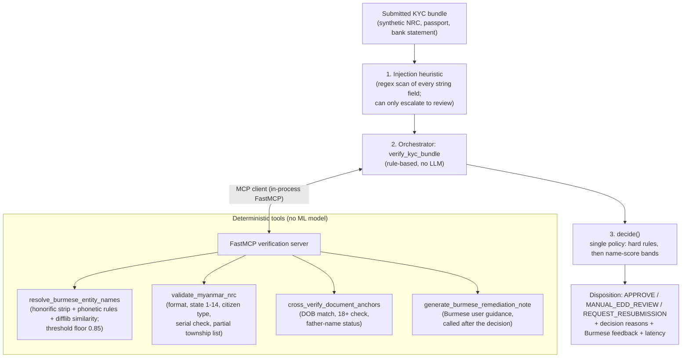

# Burmese-KYC Sentinel MCP

**Rule-based entity resolution and multi-document verification, exposed as MCP tools, for Myanmar user onboarding. Research prototype.**

[](https://www.python.org/downloads/)
[](https://gofastmcp.com/)
[](#evaluation--latency-benchmarks)
[](#privacy--data-governance)
[](https://opensource.org/licenses/MIT)

`burmese-kyc-sentinel-mcp` explores how to reduce **false rejections of genuine Myanmar customers** in KYC onboarding without loosening Enhanced Due Diligence (EDD) controls. It pairs a **Model Context Protocol (MCP)** server of deterministic verification tools with a transparent rule-based decision layer, an **adversarial prompt-injection guard**, and an evaluation harness that reports its own failures.

> **Not for production KYC.** All data is synthetic, thresholds are not calibrated on real data, the township list is a partial subset, and nothing here has been reviewed against any regulator's requirements.

Inspired by onboarding bottlenecks discussed at **Innovate Chiang Mai 2026**.

---

## Problem statement

Digital-asset exchanges face two compounding problems when verifying genuine customers from Myanmar:

1. **Naming conventions and romanization drift.**
   * Myanmar names have **no fixed surname**, and honorific prefixes change across documents (for example `Mg Aung Aung` on an NRC card and `AUNG AUNG` on a passport; `U`, `Daw`, `Ma`, `Ko`, `Saw`, `Naw` and others).
   * Burmese-to-English transliteration is inconsistent (*Nyan Linn Htun* vs *Nyan Lin Tun*, *Kyaw* vs *Chaw*, *Phyu* vs *Pyu*), so exact-match pipelines can reject legitimate users.
2. **Multi-document EDD friction.** Cross-checking several documents by hand delays onboarding, while rigid rule engines fail on minor formatting differences.

**Approach.** Split verification into deterministic MCP tools (honorific and romanization normalization, NRC structure validation, DOB / age / parent-name anchors), then apply one explicit policy that maps tool evidence to a disposition and states its reasons. Ambiguous input goes to a human, never to `APPROVE`. There is **no LLM in the decision path** in this version.

---

## System architecture



### MCP tools

| Tool | What it does |
|---|---|
| `resolve_burmese_entity_names` | Strips leading honorifics, normalizes romanization, and scores literal plus phonetic similarity (0.35 / 0.65 blend). Guard rails push token mismatches, missing or extra syllables, and order swaps into the review band. Single-syllable names are flagged as weak evidence. Burmese-script names that are not identical are flagged as not comparable. A caller-supplied `threshold` below 0.85 is raised to 0.85. |
| `validate_myanmar_nrc` | Checks NRC format (e.g. `12/MaYaKa(N)104829`), state/region code 1-14, citizen type, and rejects serial `000000`. Accepts Myanmar digits, spacing variants and full-width brackets. Checks the township against a **partial** list; an unlisted township only triggers manual review. No checksum or database lookup. |
| `cross_verify_document_anchors` | Compares NRC and passport DOB (ISO, `DD/MM/YYYY`, `DD-MM-YYYY`, Myanmar digits; day-first), applies an exact 18+ rule, and compares the father's name with a supporting document. The parent check reports one of `MATCH`, `WEAK_MATCH`, `MISMATCH`, `UNCOMPARABLE`, `NOT_PROVIDED`. |
| `generate_burmese_remediation_note` | Produces Burmese-language guidance for the customer from the flagged issues. Called after the decision; it never influences it. |

### Prompt-injection guard

Every string field in the bundle is scanned after Unicode normalization (NFKC, zero-width removal, leetspeak mapping, whitespace collapse) for instruction-override phrases in English and a few Burmese phrases. A hit **can only escalate** a case to `MANUAL_EDD_REVIEW`. This is a cheap signal, not a security boundary; the real defense is that free-text fields never reach the decision logic.

---

## Decision policy

`APPROVE` requires **all** of: valid NRC **and** verified township, name score >= 0.85 with enough evidence (>= 2 syllables), DOB match, age >= 18, no failing father-name check, and no injection flag.

| Disposition | When |
|---|---|
| `REQUEST_RESUBMISSION` | Invalid NRC, DOB mismatch or unreadable, under 18, or name score below the 0.70 review floor (likely different people). |
| `MANUAL_EDD_REVIEW` | Everything else: names in the 0.70-0.85 band, Burmese-script or empty names, weak single-syllable evidence, unverified township, father-name mismatch or uncomparable, or any injection flag. |
| `APPROVE` | All conditions above met. |

`NOT_PROVIDED` (no parent name on the supporting document) does not block approval, because many documents carry none, but it is listed in the decision reasons so it is visible that the anchor was not checked. The report returns `decision_reasons`, not a confidence score (an earlier uncalibrated one was removed).

---

## Evaluation & Latency Benchmarks

### 1. Pipeline cases (hand-written)

`evals/synthetic_kyc_cases.json` holds 29 cases: 9 approvals, 7 resubmissions, 13 manual reviews (hard negatives, Burmese script, unverified township, five prompt-injection variants). All pass with 0 false accepts. **This shows the known failure modes are fixed, not that the system generalizes:** the cases were written by the author after finding the bugs they cover.

### 2. Name-matcher evaluation (seeded synthetic pairs, held-out split)

`python -m evals.run_name_eval` generates ~7,200 labelled name pairs from a hand-curated lexicon of romanization variants and confusable names (`evals/pair_generator.py`), splits them 60/40 into dev and test **by base name**, and reports test-split results with 95% Wilson intervals. Latest run (`evals/results/name_eval_latest.json`, seed 20261121; test = 1,179 same-person and 1,811 different-person pairs):

| Shipped matcher, threshold 0.85 | Result (test) |
|---|---|
| Different people auto-accepted (**false accept**) | **87 / 1,811 = 4.8%** (95% CI 3.9-5.9%) |
| Same person auto-accepted | 1,030 / 1,179 = 87.4% |
| Same person sent to manual review | 149 / 1,179 = 12.6% |
| Same person sent to resubmission | 0 / 1,179 |

**The design goal "a false accept is the expensive error" is only partly met at the default threshold.** Of the 87 false accepts, 82 are in the *confusable names* category (Thin/Tin 24, Than/Thant 18, Mya/Myat 18, Aung/Kaung 11, Linn/Lwin 11) and 5 are random one-syllable swaps of clearly different names (1.3% of that category, e.g. Naing vs Hlaing). Order swaps, missing or extra syllables, and unrelated names had **0** false accepts.

How to read this:

* The confusable-pair labels are an assumption that these are different people. Real documents may spell one person both ways (for example a dropped final consonant), so that part is label-dependent. Thin/Tin follows directly from the documented `th -> t` merge.
* The guard rails help: the same similarity blend without them falsely accepts 435 / 1,811 (24.0%) at 0.85.
* At an operating point chosen on dev for <= 1% false accepts, the matcher's recall is about 57% on test, comparable to plain difflib and Jaro-Winkler (about 55%). Its advantage is at the lenient default threshold, which is also where the false accepts occur.
* Tuning the exact/phonetic blend weight on dev changed test AUC by only +0.001, so the hand-set 0.35 / 0.65 was kept.

**Candidate fix, measured but not shipped.** Capping the score at 0.84 when position-aligned phonetic tokens differ and are under 0.90 similar lowers test false accepts from 4.8% to 1.3% (24 / 1,811, all Thin/Tin) but also lowers auto-accepted genuine matches from 87.4% to 73.8%. That is a recall-versus-false-accept trade-off for the deploying institution, not a free win.

The script also prints baselines (difflib, Levenshtein, Jaro-Winkler, Soundex), ablations, per-category breakdowns and a score-calibration table.

### 3. Latency

`python -m benchmarks.inference_bench` times the in-process deterministic pipeline (no network, no LLM). Run it to get numbers for your machine; none are quoted here because they depend on the host.

---

## Known limitations

* **False-accept rate is not zero** (see above), and the synthetic lexicon cannot represent genuinely different names that romanize identically, so the true rate on real data is likely higher than measured.
* **Romanization is heuristic.** `th -> t`, `ht -> t` and similar rules also merge names that are genuinely different (*Thura* / *Tura*, *Thin* / *Tin*).
* **Burmese-script names and NRCs are not transliterated.** Names go to manual review; Burmese-script NRCs are rejected with a clear message.
* **`min`, `mi`, `sai`, `nang`, `khun` are treated as part of the name**, not honorifics, so *Min Aung Hlaing* vs *Aung Hlaing* goes to review.
* **Compound names written as two words** (*Thandar* vs *Than Dar*) change the token count and are always routed to review.
* **Township registry is a partial, unverified list.** Replace it with the official list.
* **No embeddings, no NRC checksum, no address check, no LLM stage.** `agent/prompts.py` is only a template for a possible future stage, which must not be able to upgrade a tool-derived decision to `APPROVE`.
* **Injection detection is a regex heuristic**, not a security boundary.
* No liveness, face match, document-authenticity, sanctions/PEP screening, or real NRC database lookup.
* Date strings like `03/04/2001` are read day-first.
* The evaluation lexicon is hand-curated and has not been verified by a native-speaker linguist or against real documents.

## Possible next steps (not implemented)

* Decide the recall / false-accept trade-off and ship or reject the token guard above.
* Add an optional LLM explanation stage that can only downgrade a decision, and measure prompt-injection robustness with and without it.
* Replace the township subset with the official list; add an address-consistency anchor.

---

## Privacy & Data Governance

* **All data in this repository is synthetic.** No real NRC numbers, names, or documents are included.
* **Do not enter real personal data into the demo.** The input fields accept free text. The app code does not persist inputs, but hosting platforms may log requests and that is outside this repository's control.
* This is a research prototype and makes no compliance claims.

---

## Quick start

```bash
python -m venv .venv && source .venv/bin/activate
pip install -e ".[dev,ui]"     # drop "ui" if you do not need the Gradio demo
pytest -q                      # unit tests + eval tests
python -m evals.run_eval       # 29 hand-written pipeline cases (confusion matrix)
python -m evals.run_name_eval  # seeded name-matcher eval: dev/test split, baselines, CIs
python -m benchmarks.inference_bench
python app.py                  # Gradio demo with 7 synthetic scenarios
```

### Deploying the demo to Hugging Face Spaces

The YAML block at the top of this file configures a Gradio Space (`app_file: app.py`, Python 3.11); `requirements.txt` lists the dependencies. Create a Space with the Gradio SDK and push this repository. Remove the YAML block if you only want the GitHub view.

## Repository layout

```
core/         name_matcher.py  nrc_registry.py  anchors.py
mcp_server/   kyc_tools.py
agent/        kyc_agent.py  prompts.py
tests/        unit tests for core, decision policy and injection scanner
evals/        synthetic cases, pair_generator, baselines, metrics, run_eval.py, run_name_eval.py
benchmarks/   inference_bench.py
docs/         architecture.mmd
app.py        Gradio demo
```

## License

MIT. See `LICENSE` (set the copyright holder before publishing).
